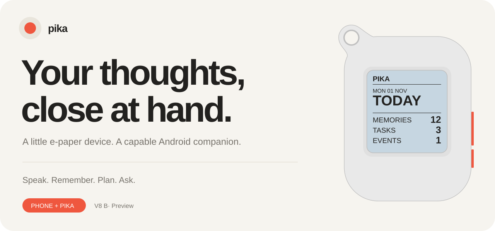
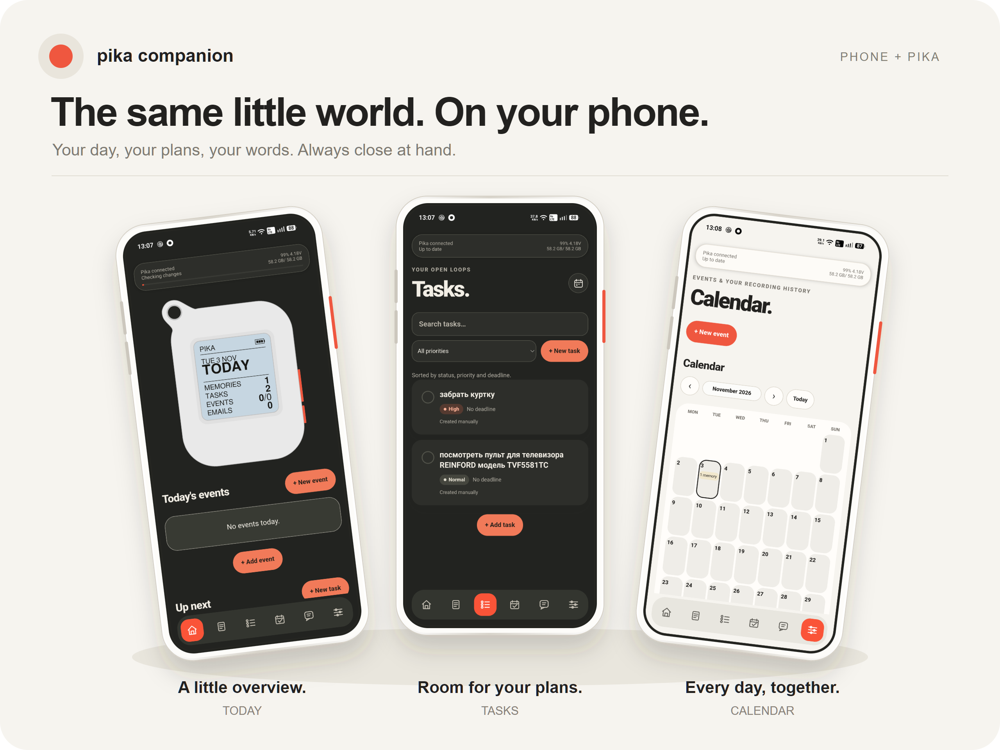
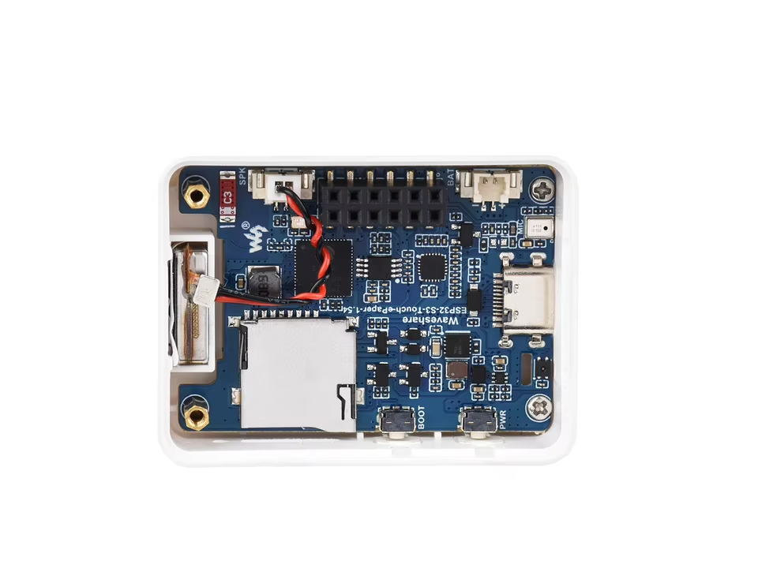

<strong>A little e-paper notebook. A full companion.</strong> Speak a thought, make a plan, continue the conversation.

<a href="https://github.com/zaera/Pika_note/releases">Download</a> · <a href="https://github.com/zaera/Pika_note/wiki">Wiki</a> · <a href="docs/wiki/Getting-started.md">Get started</a> · <a href="case">Print the case</a>

<strong>☕ Enjoying Pika Note? <a href="https://ko-fi.com/punishman">Buy me a coffee</a> 🧡 Your support helps keep this little project growing. ✨</strong>

## Your words. Your plans. One conversation.

Pika Note combines a physical voice recorder with an Android companion. The phone stores your library and handles recognition, AI, speech, mail, calendar and weather. Pika stays small: record, ask, glance, move on.

**Inspired by Pala Note 2.0, refined into the complete phone-first companion we wanted to use.** This is an independently maintained derivative, not an official upstream release. The public tree contains the current Pika implementation, not an archive of the original firmware.

| Remember | Plan | Ask |
| :--- | :--- | :--- |
| Hold, speak, release. Keep your recording and original-language transcript. | Create tasks and events explicitly through Ask, including plans drawn from a selected memory. | Talk about your records, ask general questions, search the web and continue the same conversation on Android. |

- **Bluetooth, with the phone at the center.** Incremental, bidirectional change exchange while Pika is awake.
- **Offline capture.** Record memories without phone or internet; recognition resumes later. Manually edited text is protected from automatic replacement.
- **Clear intent.** Memory capture saves notes. Ask handles planning, status changes and archive-aware queries.
- **Personal controls.** Button assignments, 1–5 minute sleep timer, sound patterns, optional GPIO2 vibration, light/dark themes and case colors.
- **Useful extra screens.** Month calendar, weather on entry, filtered read-only Gmail and task/event briefings.
- **Recovery built in.** Undo, password-encrypted complete backups, restore and USB microSD backup mode.
- **One companion interface.** Typed or voice Ask, editable records, audio playback, sharing, search and calendars.

## Pala Note 2.0 → Pika Note

This compares the starting workflow used for this project with this Pika build; it is not a survey of every upstream fork or future version.

| Area | Pala Note 2.0 baseline | Pika Note |
| :--- | :--- | :--- |
| Internet connection | Device connects through Wi-Fi | Device uses Bluetooth to Android; phone handles internet |
| Recording intent | Automatically derives tasks/events from recordings | Memory stays a memory; Ask explicitly creates and changes plans |
| Ask conversation | Questions about stored records | Unified conversation about records, general knowledge and supported web queries |
| Notifications | Limited notification behavior | Configurable scenario sounds, event reminders and optional vibration patterns |
| Companion | No equivalent full Android companion in the baseline | Full Android library, Ask, configuration, backup and sync app |

## The little board behind Pika

Built around the **Waveshare ESP32-S3-ePaper-1.54 V2**. Start with the [official Waveshare documentation](https://docs.waveshare.com/ESP32-S3-ePaper-1.54) for board resources, schematics and setup.

The current build targets **8 MB flash / 8 MB PSRAM** and the matching monochrome display. V1 and other display variants need matching firmware; check the board revision before flashing.

## Start here

1. Use a compatible Waveshare ESP32-S3-ePaper-1.54 board, matching monochrome display, microphone/speaker and microSD. Display variants need their own driver.
2. Download matching firmware **8.0.4** and Companion **8.0.6-preview** from [Releases](https://github.com/zaera/Pika_note/releases).
3. Install the APK on Android **8+**, enable Bluetooth and grant the requested permissions.
4. Wake Pika. In Companion choose **Get started → Find Pika**, then confirm the displayed code.
5. Add your own OpenAI API key in the required setup step. Google services, theme and app PIN are optional.

Default Today holds: **upper = Memory**, **lower = Ask**. Offline memories are retained. Ask mutations are explicit; archived records are consulted when you ask about the archive.

### Update over USB

On Windows, install **Python 3.10+**, connect and wake Pika, then double-click [`tools/flash_pika.bat`](tools/flash_pika.bat). Enter its COM port when asked. The updater downloads the latest published firmware (including previews), verifies SHA-256, follows Pika into its bootloader even if the port changes, flashes and restarts it. Required Python packages are installed in a private cache on first use.

Back up first and safely eject USB SD Backup mode. Ordinary updates keep settings and SD files; the firmware boot selector is reset so the new application starts. First installation on a **new/erased supported board** uses `python tools/flash_pika.py --install`. See [build/update instructions](docs/wiki/Building.md).

## Build & explore

| Path | Contents |
| :--- | :--- |
| `pika_note/` | Current device firmware and board support |
| `android-companion/` | Complete Android app source and bundled interface |
| `tools/` | Build helpers, font generation and regression checks |
| `docs/wiki/` | Versioned user guide, also published to Wiki |
| `case/stl/` | Current printable case, cover and buttons from STL2 |

See [Building](docs/wiki/Building.md), [Hardware](docs/wiki/Hardware.md), [Architecture](docs/wiki/Architecture.md) and [incremental catalog design](docs/INCREMENTAL_CATALOG.md).

## Before you begin

This is a tested **preview**, with device-specific hardware requirements. Back up before updating or changing ownership. Internet features need phone connectivity and your own provider credentials; API usage can cost money. A ChatGPT subscription does not include API usage.

Gmail is read-only. Google Calendar export/import is not a general two-way merge of existing Google edits. The microSD is **not encrypted**; password-encrypted portable backups are separate. Forget/unpair is destructive and must be preceded by a backup.

## Credits & licenses

Inspired by **Pala Note 2.0**. Hardware support builds on Waveshare and Espressif components; fonts and dependencies retain their own licenses. See [third-party notices](THIRD_PARTY.md) and [license texts](licenses). Original source notices are preserved. No blanket relicensing or affiliation is implied.
